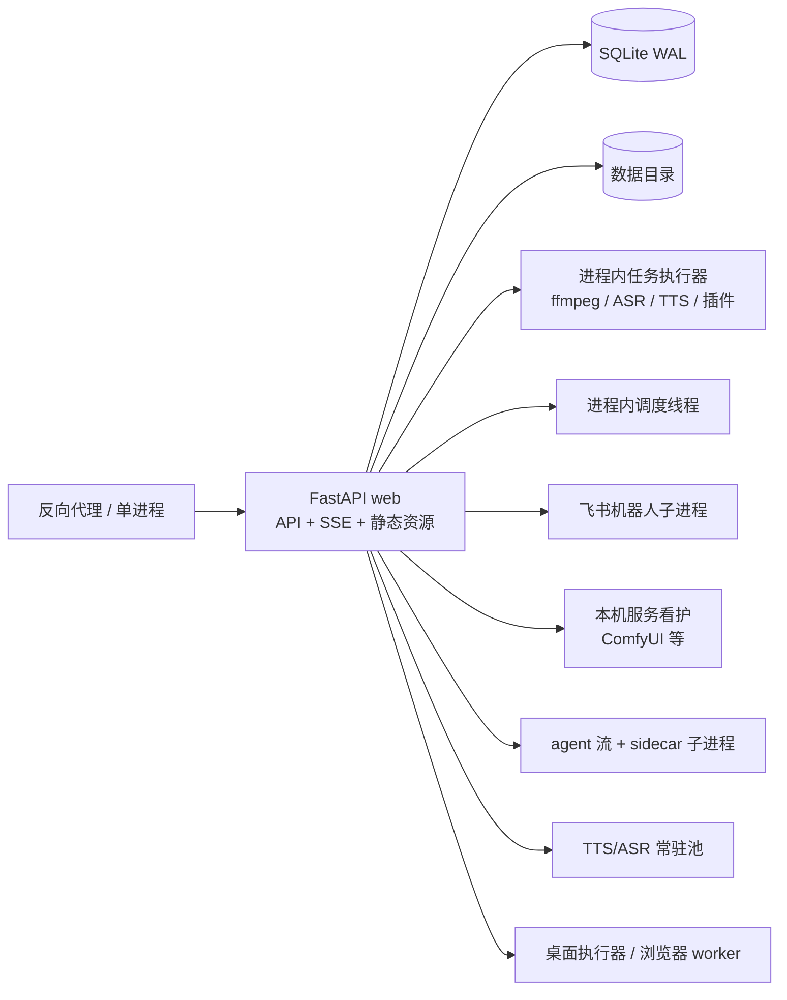

# 多后端进程就绪规划

> 2026-10-27 · 规划，不实施 · 依据 [`docs/PROCESS_STATE.md`](../PROCESS_STATE.md) 与当前代码盘点

## 结论

**不要先换 Postgres，也不要直接 `uvicorn --workers 2`。**

当前后端把三类完全不同的东西混在同一个进程里：

1. **必须共享的协调状态**：OAuth 待完成流、供应商令牌刷新租约、发布任务认领、成员最后所有者检查、定时任务。
2. **天然属于某一个进程的资源**：子进程句柄、任务执行器、飞书机器人子进程、智能体 SSE 流、本机服务看护、TTS/ASR 常驻池。
3. **可以各自一份的缓存**：模型目录、预览图索引、NSFW 分数、帧条、导入期注册表。

只换数据库不会解决第 2 类；只起多个 web 进程会让第 1、2 类同时失去正确性。
推荐按“**共享协调下沉到数据库 + 副作用进程单例化 + 缓存允许重复**”三步走。

桌面版继续限定**一个后端进程**；本规划只针对服务器/多 worker 形态。

## 目标与非目标

### 目标

- 同一数据目录上安全运行 2 个及以上 web 进程。
- 用户可见副作用**最多发生一次**：发布、下载、成员变更、定时任务、飞书消息、OAuth 回调。
- 任一进程崩溃后，租约在 TTL 内可被别人接管，不留下永久占用。
- 长任务、子进程和流式会话有明确的归属进程；web 进程可以重启而不丢正在进行的轮次。
- 单进程部署保持今天的行为和性能，不需要两套运行模式。

### 非目标

- 本阶段不追求多主机、跨可用区或跨容器共享 SQLite。
- 不把桌面版改成多后端。
- 不为“缓存重复计算”做分布式缓存；先接受多算一遍。
- 不在没有并发验证的情况下把全部状态一次性搬进 Redis。

## 当前拓扑



第二个 web 进程会同时复制任务执行器、调度线程、飞书子进程、本机服务看护和常驻模型池。它们不是“缓存”，而是有外部副作用的资源。

## 状态分类

完整逐项清单见 [`docs/PROCESS_STATE.md`](../PROCESS_STATE.md)。本规划只按**处理方式**分组。

### A. 必须变成共享协调状态

| 状态 | 现在的风险 | 目标机制 |
|---|---|---|
| `app/api/routes/oauth.py:_pending` | 回调落到另一个进程 → state 不匹配 | 数据库表 `oauth_pending`，带 `state`、PKCE、`expires_at` |
| `app/domain/providers/auth.py:_leases` | 两进程同时刷新同一令牌，后写者作废 refresh token | 数据库租约 + fencing token |
| `app/domain/publish/worker.py` 的认领 | 多个认领者重复领同一条发布任务 | 原子认领 + 租约；多主机时用 `FOR UPDATE SKIP LOCKED` |
| `app/domain/members.py:_lock` | 最后两个所有者可同时被降级 | 条件更新（按剩余所有者数量判断） |
| `app/domain/agent/autopilot.py:ALLOWANCE_LOCK` | “始终允许”读改写互相覆盖 | 行版本/CAS 更新 |
| `app/domain/model_library.py:_pending_downloads` | 两进程各自占位，同一 `.part` 排两条任务 | 数据库唯一占位行；插件 `O_EXCL` 仍是最后防线 |
| `app/domain/workflows/approvals.py:_RESUMED` | 两条唤醒路各派一次恢复 | 数据库幂等键，而不是进程内标记 |
| `app/domain/voices/remote.py:_copy_locks` | 远端多建一份克隆音色 | 数据库租约（按副本 key） |
| `app/domain/blender/bridge.py:_locks` | 同一 `.blend` 被两次同步同时驱动 | 数据库租约（按连接） |
| `app/domain/plugins/registry.py:_INSTALL_LOCK`、`local_services` 目录锁 | 同一目录被两个进程同时安装/启动 | 数据库租约 + 文件系统锁双重保护 |
| `app/core/rate_limit.py:WindowLimiter._events` | 每进程一份额度 | 共享计数表或入口网关限流 |
| `app/core/worker_key.py:_key` | 执行器只认一个进程的随机 key | **已有出路**：部署固定 `MOSAEL_WORKER_KEY` |

这些状态的共同点：**失败不会立刻报错，只会产生重复副作用或静默丢数据**。应优先处理。

### B. 必须收成单例的资源

| 资源 | 为什么不能每个 web 一份 | 目标形态 |
|---|---|---|
| `app/domain/jobs.py:_runner`、`_CHILDREN`、`_KILLED`、各类 slots | 每进程一套 16 个名额；取消只能杀本进程子进程；重启丢失队列 | 单独 job worker 进程，数据库出队/心跳/租约；web 只入队 |
| `app/workers/scheduler.py:_stop_event` | 每进程一个调度线程，同一 cron 触发多次 | 单例 scheduler worker（租约选主） |
| 飞书 `connections._processes/_pumps` | 每进程再拉一份 lark 子进程，同一条消息处理两次 | 单例飞书连接 worker；消息经 outbox |
| `app/domain/agent/login.py:_sessions` | 浏览器窗口只在发起进程；轮询落到别处查无会话 | 单例登录 worker，或短期路由到 owner 进程 |
| `app/domain/agent/stream.py:_streams`、`pi_client._LIVE` | SSE 和 sidecar 轮次绑进程；崩溃会卡“思考中” | 独立 agent runner + 可恢复事件流；短期可 sticky |
| `local_services.supervisor/_services/_directories` | 同一 ComfyUI 起两份撞端口 | 单例 local-service supervisor |
| `local_services.installer._runs` | 两进程同时安装同一连接 | 单例 installer worker + 租约 |
| TTS/ASR `_POOL` | 每进程再加载一份模型，显存翻倍 | 独立推理 worker；web 通过队列调用 |
| `browser/__init__.py:_executor_contact` | 只错一句“执行器是否在线”的提示 | 可保留进程内；不阻塞多进程 |

这些资源的关键不是“共享”，而是**只有一个进程能做**。把它们留在 web 进程里，再多的数据库租约也无法让子进程句柄跨进程。

### C. 可以每进程一份

模型目录缓存、模型预览索引/抓取名额、NSFW 分数与队列、帧条锁、插件目录巡检退避、ffmpeg 探测、序列 JSON 缓存、导入期注册表。

多进程的代价是**重复计算**，不是错误。只有以下情况才需要额外处理：

- 显存/CPU 预算按进程数翻倍（TTS/ASR 池不在此列，已经归 B 类）。
- 外部限流或远端账号配额按进程数翻倍（模型预览抓取、NSFW 分类、飞书 token）。
- 缓存写入同一文件时后写覆盖先写——目前都是同值重算，先接受。

## 需要的原语

### 1. 实例身份与租约表

最小表形状：

```text
coordination_leases
  kind          -- oauth / provider_refresh / publish_claim / scheduler / ...
  key           -- 业务唯一键（令牌 id、任务 id、目录…）
  owner_id      -- 进程实例 id
  fencing_token -- 单调递增，每次取得租约 +1
  expires_at
  payload       -- 可选：锁内需要交接的数据
  PRIMARY KEY (kind, key)
```

要求：

- 取得租约必须原子：`INSERT` 冲突时校验过期，再 `UPDATE` 并递增 `fencing_token`。
- 所有受保护的写回都带 `fencing_token`；旧持有者即使没收到过期通知，也不能覆盖新持有者的结果。
- 租约 TTL 要覆盖最长网络操作，并在操作中续租。
- 释放是删除或置空；进程崩溃由 TTL 接管。

SQLite 可用 `BEGIN IMMEDIATE` 包住“查过期 → 更新”，但写冲突会串行化；单机多进程足够，多主机不可用。
Postgres 使用行锁或 `FOR UPDATE SKIP LOCKED`，这是多主机才需要换库的**真正理由**。

### 2. 单例 worker 注册

- `worker_instances(id, role, started_at, heartbeat_at, expires_at)`。
- 每个角色（scheduler、job-runner、feishu、local-services、agent-runner）通过租约选主。
- 租约丢失立即停止领新工作；旧 worker 的 fencing token 阻止迟到写入。
- web 进程不直接调用这些 worker 的内存 API，只通过数据库/队列交接工作。

### 3. 流与会话归属

短期方案：反向代理用一致性哈希或 cookie sticky，把 OAuth 回调、agent SSE、登录轮询固定到 owner。
但这只是**掩盖**，不解决 owner 崩溃；长期仍需：

- agent 事件落库（`agent_turn_events` 已有基础），SSE 从事件表续读；
- sidecar 轮次由 agent-runner 持有，web 只转发；
- 登录会话由单例 worker 持有，HTTP 只查状态。

## 分阶段实施

### Phase 0：选择拓扑与加护栏

先决定目标形态：

| 方案 | 适用 | 代价 |
|---|---|---|
| A. 仍单 web，只拆 worker/scheduler/feishu | 追求稳定性、崩溃恢复，不追求 web 并发 | 最小；多数单机部署够用 |
| B. 多 web + 单例 worker + 数据库协调 | 同机多进程、短请求并发 | 需要租约、队列、流归属 |
| C. 多主机 + Postgres + 独立 worker | 云端水平扩展 | 迁移 SQL/JSON/PRAGMA，成本最高 |

建议先做 **B 的最小闭环**，把 C 留到有明确多主机需求时。

Phase 0 交付：

- 本文档 + 决策记录（选 A/B/C、是否允许 sticky、SQLite 还是 Postgres）。
- 两进程测试骨架：共享临时数据目录、两个端口、一个 fake worker。
- 启动日志打印实例 id、角色、`MOSAEL_WORKER_KEY` 是否固定。
- 明确桌面版只允许一个后端进程。

### Phase 1：共享协调状态

1. `MOSAEL_WORKER_KEY` 成为多进程部署硬要求；缺失时启动失败或显著告警。
2. `oauth_pending` 入库。
3. provider refresh 改数据库租约 + fencing。
4. publish claim 改原子认领 + 租约；先 SQLite 单机，多主机再 Postgres。
5. members 最后所有者改条件更新；autopilot allow 改 CAS。
6. download reservation 入库，删掉进程内 `_pending_downloads`。
7. 共享限流（数据库窗口或入口网关）。

验收：

- 两个 web 进程并发跑同一组测试，副作用计数仍为 1。
- OAuth callback 随机打到任一端口都能完成。
- 两进程同时刷新同一 provider token，只发一次刷新请求。
- 两个 publish worker 只领到同一条任务一次。
- SIGKILL 持锁进程后，TTL 内另一个进程接管。

### Phase 2：副作用进程单例化

按“外部副作用最大、最容易重复”排序：

1. job runner / scheduler 从 web 拆出；web 只入队。
2. 飞书连接与消息泵单例化，消息 outbox 化。
3. local-services supervisor/installer 单例化。
4. TTS/ASR 池移到推理 worker。
5. agent login、agent runner、SSE 归属与续读。
6. browser executor 继续走现有认领协议，固定 worker key。

验收：

- 起两个 web，只存在一份调度线程、一份飞书子进程、一份 ComfyUI。
- 杀掉 worker，任务在租约到期后由另一个 worker 接管，不重复执行已提交副作用。
- web 滚动重启时 agent 事件不丢、SSE 可续。

### Phase 3：多主机（可选）

只有 Phase 2 完成且出现多主机需求时：

- SQLite → Postgres，处理 JSON、部分索引、`PRAGMA`、迁移引导、WAL 假设。
- 对象存储/共享文件系统替代本机数据目录。
- 租约改为行锁/`SKIP LOCKED`；缓存可引入 Redis，但不是前置条件。
- 跨主机 worker key、网络策略、出站代理与文件路径重新审计。

## 测试矩阵

| 场景 | 断言 |
|---|---|
| 两个 web 同时 OAuth callback | 只有一次 state 消费，成功落在任一进程 |
| 两个请求同时刷新同一 provider token | 上游只收到一次刷新 |
| 两个 publish worker 同时认领 | 同一条任务只被一个 worker 执行 |
| 两个进程同时降级最后两个 owner | 至少保留一个 owner |
| 两个进程同时下载同一模型文件 | 只建一条任务/一个 `.part` |
| 两个 scheduler 同时启动 | 同一 cron 只触发一次 |
| 持锁进程 SIGKILL | TTL 后接管，旧 fencing token 不能写回 |
| web 重启时 agent SSE | 事件不丢，客户端可续读 |
| 两个 web 同时抓同一模型预览 | 允许重复，但外部配额有上限或可接受 |

## 反模式

- **直接 `--workers 2`**：会同时复制调度器、飞书、本地服务和任务队列。
- **用 sticky session 当正确性方案**：owner 崩溃后仍会丢会话/回调。
- **用文件锁做跨主机协调**：容器/主机间不共享锁语义。
- **只换 Postgres 不拆 worker**：重复副作用不会消失，只是写冲突更贵。
- **租约没有 fencing**：过期持有者恢复后仍可能覆盖新结果。
- **把长生命周期子进程留在 web**：滚动发布必然打断导出/转写/登录。

## 需要维护者决定

1. 目标是 **A 稳定性**、**B 同机多进程**，还是 **C 多主机**？
2. 是否接受短期 sticky（OAuth/SSE/登录）作为过渡，还是要求 owner 崩溃可恢复？
3. 多进程部署是否只支持“同机共享数据目录”的 SQLite，还是第一阶段就要求 Postgres？
4. 哪一类副作用最先必须做到“全局最多一次”：发布、导出、定时任务、飞书消息、模型下载？

**建议默认答案**：先选 B，SQLite 单机 + 数据库租约；Phase 1 只覆盖 OAuth、provider refresh、publish claim、members、scheduler；Phase 2 再拆 job/feishu/local-services/agent。C 暂不作为近期目标。
